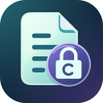

# سایفرشیلد (CipherShield)

[English](README.md)

سایفرشیلد متن را در اندروید ۸ و بالاتر با گذرواژه رمزگذاری می‌کند. مثلاً می‌توانید تنظیمات WireGuard را رمزگذاری کنید، متن رمزگذاری‌شده را در یک پیام بفرستید و گذرواژه را از راه دیگری به گیرنده برسانید. گیرنده با سایفرشیلد یا نرم‌افزار سازگار می‌تواند متن اصلی را بازیابی کند. رمزگذاری و رمزگشایی روی دستگاه انجام می‌شود و به حساب کاربری یا اینترنت نیازی ندارد.

## چه چیزی را می‌توانم رمزگذاری کنم؟

سایفرشیلد تا **۵ مِبی‌بایت متن با کدگذاری UTF-8** را می‌پذیرد؛ پسوند فایل مهم نیست. پیام‌ها، متن پیامکی که خودتان وارد می‌کنید، یادداشت‌ها، اطلاعات ورود، فایل‌های JSON و CSV و تنظیمات متنی VPN مانند WireGuard و OpenVPN همگی قابل رمزگذاری‌اند. حروف فارسی، ایموجی، فاصله‌ها و شکست خطوط حفظ می‌شوند.

برنامه فقط از متنی که به آن می‌دهید محافظت می‌کند. صندوق پیامک را نمی‌خواند، به سرور VPN متصل نمی‌شود و برای رمزگذاری فایل‌های باینری مانند PDF یا اسناد Office طراحی نشده است.

## چطور متن را رمزگذاری و ارسال کنم؟

1. بخش **Encrypt** را باز کنید. متن را بنویسید یا بچسبانید، از فایل وارد کنید، یا کد QR را با دوربین یا از روی تصویر بخوانید.
2. گذرواژه‌ای یکتا با حداقل ۱۶ نویسه وارد کنید که برنامه آن را **Strong** یا **Excellent** ارزیابی کند. با **Generate Key** هم می‌توانید یک گذرواژهٔ تصادفی ۲۴ نویسه‌ای بسازید.
3. **Encrypt text** را بزنید. نتیجه را کپی کنید، به‌صورت کد QR نمایش دهید یا با **Save encrypted file** در فایل ذخیره کنید. برای پیام‌های طولانی، فایل گزینهٔ مطمئن‌تری از QR یا کلیپ‌بورد است.

**پیش از باز کردن پنجرهٔ انتخاب فایل، گذرواژه را در جای امنی نگه دارید.** با رفتن برنامه به پس‌زمینه، کلید نمایش‌داده‌شده پاک می‌شود. گذرواژه را از مسیر مطمئن دیگری بفرستید؛ هر کسی که هم گذرواژه و هم متن رمزگذاری‌شده را داشته باشد می‌تواند پیام را بخواند. سایفرشیلد امکان بازنشانی گذرواژهٔ فراموش‌شده را ندارد.

## چطور متن را رمزگشایی کنم؟

در بخش **Decrypt**، متن رمزگذاری‌شده را بچسبانید، اسکن کنید یا از فایل وارد کنید. گذرواژهٔ دقیق را بنویسید و **Decrypt text** را بزنید. اگر رمزگشایی انجام نشد، فاصله‌ها و بزرگی و کوچکی حروف گذرواژه را بررسی کنید و مطمئن شوید پیام رمزگذاری‌شده کامل و بدون تغییر به دست شما رسیده است.

نتیجهٔ رمزگشایی **۳۰ ثانیه** نمایش داده می‌شود. در صورت نیاز آن را کپی کنید یا با تأیید **Save decrypted text…** یک فایل بدون رمزگذاری ذخیره کنید. این فایل **منقضی نمی‌شود**. برای متن‌های طولانی ممکن است فقط بخشی از نتیجه در پیش‌نمایش دیده شود، اما کپی و ذخیره روی متن کامل انجام می‌شود.

## رمزگذاری چگونه کار می‌کند؟

سایفرشیلد برای هر پیام تازه، یک نمک (salt) و یک بردار آغازین (IV) تصادفی تولید می‌کند. برنامه با **PBKDF2-HMAC-SHA512** و ۶۰۰٬۰۰۰ تکرار از گذرواژه کلید می‌سازد، متن را با **AES-256-GCM** رمزگذاری می‌کند و برای بررسی صحت بسته از **HMAC-SHA512** با کلیدی جداگانه استفاده می‌کند. به همین دلیل، دو بار رمزگذاری یک متن حتی با همان گذرواژه خروجی یکسانی ندارد. با گذرواژهٔ اشتباه یا بستهٔ دست‌کاری‌شده، متن اصلی نمایش داده نمی‌شود.

خروجی به‌شکل **Base64** نمایش داده می‌شود تا بتوان آن را مثل متن معمولی فرستاد؛ خود Base64 رمزگذاری نیست. پیام‌های جدید در قالب **CSv3** تولید می‌شوند و برنامه همچنان بسته‌های قدیمی سازگار با **CSv2** را رمزگشایی می‌کند. بررسی صحت پیام به معنی اثبات هویت فرستنده نیست.

## حریم خصوصی چه محدودیت‌هایی دارد؟

- سایفرشیلد مجوز اینترنت ندارد، اما پیام‌رسان یا سرویس ابری که خودتان انتخاب می‌کنید ممکن است از اتصال اینترنت خودش استفاده کند. اگر فایل نباید از دستگاه خارج شود، یک پوشهٔ محلی انتخاب کنید.
- با رفتن برنامه به پس‌زمینه، ورودی‌ها و نتیجه از رابط برنامه پاک می‌شوند. اگر خودتان ذخیره در فایل را انتخاب کنید، متن تا انتخاب مقصد و پایان نوشتن فایل در حافظه می‌ماند.
- وقتی گذرواژه یا متن رمزگشایی‌شده را کپی می‌کنید، سایفرشیلد آن را به‌عنوان دادهٔ حساس علامت می‌زند و پس از ۶۰ ثانیه تلاش می‌کند همان محتوا را از کلیپ‌بورد پاک کند. محدودیت‌های اندروید یا کپی‌هایی که برنامه‌های دیگر برداشته‌اند می‌توانند مانع حذف کامل شوند.
- رمزگذاری از نسخهٔ رمزگذاری‌شده محافظت می‌کند. فایل اصلی، نسخهٔ بدون رمزی که ذخیره کرده‌اید و متنی که یک صفحه‌کلید نامطمئن می‌بیند، تحت این حفاظت نیستند. گذرواژهٔ ضعیف را همچنان می‌توان به‌صورت آفلاین حدس زد.

برای جزئیات بیشتر، [توضیح محدودیت‌های امنیتی (انگلیسی)](SECURITY.md) را بخوانید.

توسعه‌دهنده: **SONIX**

سایفرشیلد تحت [پروانهٔ عمومی همگانی گنو، فقط نسخهٔ ۳](LICENSE) (`GPL-3.0-only`) منتشر می‌شود. اجزای شخص ثالث تابع مجوزهای خود هستند.
