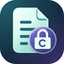

# CipherShield

[فارسی](README.fa.md)

CipherShield protects text with a password on Android 8.0 and newer. For example, you can encrypt a WireGuard configuration, send the encrypted text in a message, and give the recipient the password separately. They can open it with CipherShield or compatible software. Encryption and decryption happen on the device, without an account or internet connection.

## What can I protect?

CipherShield accepts up to **5 MiB of UTF-8 text**, regardless of the filename extension. That includes messages, SMS text you paste yourself, notes, credentials, JSON, CSV, and text-based VPN configurations such as WireGuard or OpenVPN. Persian, emoji, line breaks and spaces are preserved.

The app protects the text you provide. It doesn’t read your SMS inbox, connect to VPN servers, or encrypt arbitrary binary files such as PDFs or Office documents.

## Encrypt and share

1. Open **Encrypt**. Type or paste text, import a text file, or scan a QR code with the camera or from an image.
2. Enter a unique password of at least 16 characters that the app rates **Strong** or **Excellent**, or choose **Generate Key** for a random 24-character password.
3. Select **Encrypt text**. Copy the encrypted result, show it as a QR code, or choose **Save encrypted file**. For long messages, a file is more reliable than a QR code or the clipboard.

**Keep the password before opening the file picker.** Leaving the app clears the displayed key. Send the password through a separate trusted channel: anyone who gets both the password and the encrypted text can read the original. CipherShield cannot reset a lost password.

## Decrypt and read

Open **Decrypt**, paste, scan or import the encrypted result, enter the exact password, and select **Decrypt text**. If decryption fails, check that the password matches (including spaces and letter case) and that the entire encrypted message arrived unchanged.

The decrypted result is displayed for **30 seconds**. Copy it if needed, or confirm **Save decrypted text…** to keep an unencrypted file. That file does **not** expire. Large results may have a shortened preview; copying or saving uses the full text.

## How encryption works

For each new message, CipherShield generates a fresh random salt and IV. It uses **PBKDF2-HMAC-SHA512** with 600,000 iterations to derive keys from your password, encrypts with **AES-256-GCM**, and checks the integrity of the encrypted package with a separate **HMAC-SHA512** key. Encrypting the same text twice produces different outputs. A wrong password or a modified package won’t reveal the plaintext.

The result uses **Base64** so it can travel as ordinary text; Base64 itself is not encryption. New messages use the **CSv3** format, and the app can still decrypt supported legacy **CSv2** messages. The integrity check does not prove who sent a message.

## What stays private?

- CipherShield has no internet permission. A messaging app or cloud file provider you choose can still use its own connection. Select a local folder if a file must stay on your device.
- Inputs and results clear when the app goes into the background. An explicit file export keeps the selected text in memory while you choose the destination and the file is written.
- When you copy a password or decrypted text, CipherShield marks it as sensitive and tries to clear the matching clipboard contents after 60 seconds. Android restrictions or other apps can prevent complete removal.
- Encryption protects the encrypted copy, not the original file, an exported plaintext copy, or text seen by an untrusted keyboard. A weak password can still be guessed offline.

For more on these limits, see the [security model](SECURITY.md).

Developed by **SONIX**.

CipherShield is licensed under the [GNU General Public License, version 3 only](LICENSE) (`GPL-3.0-only`). Third-party components retain their respective licenses.
